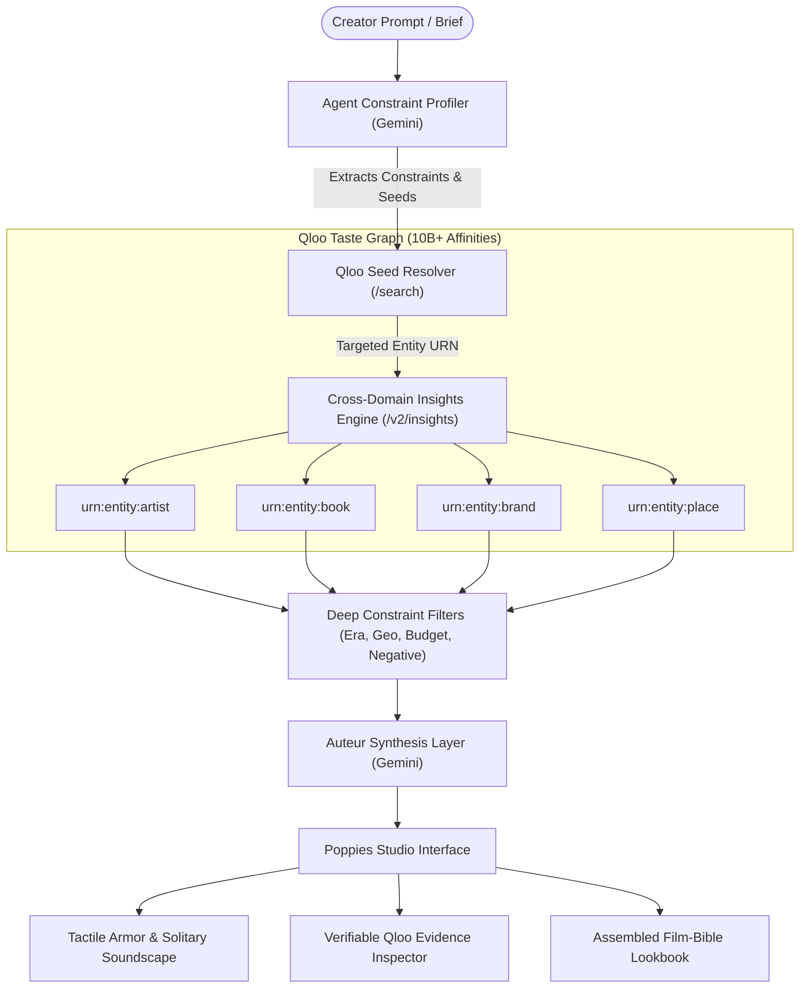

# POPPIES

### A Culturally Grounded Character & World-Building Studio Powered by Qloo

> **"Characters don't feel fake because they lack backstory. They feel fake because their choices feel generic."**

[](https://qlooagentichackathon.devpost.com/)
[](https://nextjs.org/)
[](https://www.typescriptlang.org/)
[](https://ai.google.dev/)

---

## The Problem: The AI Cultural Monoculture Trap

When a screenwriter, novelist, game narrative designer, or production director asks a frontier Large Language Model (GPT-4, Claude, Gemini) to detail a fictional character, the result is almost always a cardboard cutout.

- Prompt an LLM for a **Japanese architect in Nagoya**: It invariably gives them *Hasami porcelain*, *Tanizaki’s In Praise of Shadows*, *Erik Satie*, and a *Rotring 600 pencil*. Every single run.
- Prompt for an **underground Berlin DJ**: It gives them all-black techwear, Club-Mate, and minimal techno at Berghain.
- Prompt for a **hardboiled detective**: It gives them cheap bourbon, Miles Davis, and a rain-slicked trench coat.
- Prompt for a **rebel skater**: It gives them *The Sex Pistols* or *The Ramones*.

### Why a Base LLM Mathematically Cannot Solve This in a Million Years

Large Language Models operate on **next-token probability**. Their loss functions are calibrated to predict the most likely token sequence given the internet text they were trained on. 

By mathematical definition, when an LLM is asked to flesh out an archetype, it collapses into the **top 0.01% statistical mean of internet culture**. 

- An LLM only knows which words frequently co-occur in articles, Wikipedia pages, and forum posts.
- An LLM has **zero empirical understanding of how human taste actually clusters across domains in reality**.
- Prompting an LLM harder or adding chain-of-thought does not fix this. It merely rationalizes the same clichéd consensus with more eloquent vocabulary.

The result is **Cultural Beige**: characters that feel written from tropes rather than lived-in, leaving script readers, game players, and audiences completely detached.

---

## The Solution: Empirical Cultural Intelligence via Qloo

**Poppies** bridges frontier reasoning with **Qloo’s Taste Graph**—an empirical map of over **10 billion cross-domain affinities across 250+ million entities** (music, literature, cinema, fashion, dining, tactile objects, and physical places).

Qloo does not predict words; it measures real-world behavioral co-occurrence:
- It knows that an architect drawn to ambient soundscapes like *Roberto Musci* or *Meitei* does not buy generic commercial stationery; they carry a specific French *Opinel No. 8 carbon knife* or seek out Gaston Bachelard's *The Poetics of Space*.
- It knows that an architectural conservator restoring 18th-century limestone in Marseille doesn't eat at tourist spots along the Old Port; they frequent hyper-local neighborhood spots and pack rugged, utilitarian gear (*Knipex, Danner, Carhartt WIP*).

Instead of guessing from internet stereotypes, Poppies grounds character development in **how real humans with specific subcultural affinities actually behave**.

---

## Who This Is For

| Audience | The Bottleneck They Face | What Poppies Delivers |
| :--- | :--- | :--- |
| **Screenwriters & Showrunners** | Weeks spent manually researching subcultures, or falling back on writer's room clichés | Production-ready Character Bibles grounded in authentic subcultural texture and unexpected human contradictions |
| **Game Narrative Designers** | Open worlds populated with flat, repetitive NPCs and copy-paste flavor text | Deeply differentiated factions, characters, and ambient lore anchored in period and regional reality |
| **Novelists & Authors** | Risk of writing shallow or stereotyping portrayals of subcultures they haven't personally lived in | Culturally coherent material armor, reading habits, and private spaces backed by empirical human data |
| **Production & Art Designers** | Hours searching for era- and socioeconomically accurate set dressing, props, and wardrobe | Specific, tactile physical objects with verified provenance, canonical entity IDs, and design rationales |

---

## Beyond Barebones Lists: The Auteur Inference Layer

A raw list of brands with percentage badges is an e-commerce catalog or a Spotify playlist, not a character. Creative directors reject raw data feeds.

Poppies passes Qloo's empirical graph through the **Auteur Inference Layer**, translating cultural data into four dramatic functions:

1. **Tactile Physical Armor:** The everyday tools, knives, pens, and worn garments that shield the character from the world or serve as functional extensions of their labor.
2. **Solitary Acoustic Shield:** The private soundscapes they put on when completely alone, marking the boundary between their public performance and private exhaustion.
3. **Intellectual Lineage:** The dog-eared books, essays, and architectural texts that secretly underpin their unspoken life philosophy.
4. **The Behavioral Contradiction / Friction:** The jarring, lowbrow, or abrasive obsession that breaks their surface aesthetic and prevents them from feeling curated (e.g., a serene train station architect who restores battered 1970s pachinko cabinets at 2 AM to blistering Japanese harsh noise).

---

## The Proof: 18-Run Empirical Benchmark Evidence

Poppies was evaluated across **18 rigorous benchmark runs** comparing Base Gemini against Poppies (Qloo Engine + Auteur Agent) across 3 distinct creative scenarios:

| Metric / Scenario | Scenario 1: Standard Tsukuru (Nagoya Station Architect) | Scenario 2: Friction Tsukuru (Pachinko & Harsh Noise Fixation) | Scenario 3: Divergence Test (Tsukuru vs. Kenji - Osaka Skate/DIY Builder) |
| :--- | :--- | :--- | :--- |
| **Base LLM** *(Vanilla Gemini Flash)* | **Cliché Loop Collapse:** 3/3 runs defaulted to *Hasami porcelain*, *Tanizaki's In Praise of Shadows*, *Erik Satie*, and *Glenn Gould*. Run 3 suffered a meta-fictional leak, recommending the character read the Murakami novel about himself. | **Isolated Gimmick:** Picked noise artists (*Merzbow*) and soldering tools, but failed cross-domain integration. Bookshelf remained 100% identical cliché (*Tanizaki* and *Murakami*). | **Monoculture Failure:** Gemini gave Kenji the **exact same books, drafting pens, and ambient tracks** as Tsukuru (*Tanizaki, Rotring 600, Hiroshi Yoshimura*) simply because both were Japanese architects. |
| **Poppies** *(Qloo Engine + Auteur Agent)* | **Deep Latent Grounding:** Surfaced Gaston Bachelard's *The Poetics of Space*, Kōbō Abe, and Yasunari Kawabata; authentic Japanese ambient (*Meitei, Roberto Musci, Emily A. Sprague*); anchored in verified Nagoya haunts (*Guagliò, Malikafe*). | **Cross-Domain Friction:** Industrial grit shifted object taste into rugged craft (*Snow Peak titanium, Leatherman, 5.11 Tactical, Danner*) and electronic tape pioneers (*Ryuichi Sakamoto, Rei Harakami*). | **Subcultural Divergence:** Grounded Kenji in rugged DIY workwear and moped repair (*Opinel knives, 5.11 Tactical, Danner, Rocky boots*), completely shattering Tsukuru’s porcelain mold. |

---

## Key Features

### 1. Dual-Origin Inquiries (`[You]` vs `[Agent]`)
- **`[You]` (Creator-Directed):** Inquiries derived directly from the user's creative prompt (e.g., *What drafting tools rest on his desk?*, *What does he listen to on rainy platforms?*).
- **`[Agent]` (Autonomous Discoveries):** Autonomous investigations launched by the agent upon discovering latent affinity anomalies in the Qloo graph (e.g., *The Solitary Haunt*, *The Friction / Contradiction*).

### 2. Deep Constraint Architecture
To prevent hallucinations, cultural incoherence, and geographic bleed, Poppies enforces strict boundaries:
- **Era & Temporal Anchoring:** Distinguishes between the setting era (e.g., 2026) and vintage fixations (e.g., restoring 1970s pachinko cabinets using contemporary Hakko soldering irons).
- **Geographic & Regional Bounding:** Hard-filters night walks, dining spots, and local haunts to the character's active city (e.g., Nagoya, Marseille) to prevent international collaborative-filtering bleed.
- **Socioeconomic Budget Realism:** Anchors objects in working-class craft brands (*Knipex, Tajima, Carhartt, Opinel*) rather than arbitrarily assigning \$500 luxury items.
- **Negative Curatorial Filters:** Eliminates commercial noise (automotive brand leaks in tool queries, mass-market airport thrillers in literary queries).

### 3. Live Qloo Engine Toggle & Visual Metaphor
- Built directly into the studio header: `[ ✦ Qloo Taste Graph (Active) | Vanilla Base LLM ]`.
- Switching to Base LLM applies a global CSS desaturation filter (`filter: grayscale(85%) contrast(95%)`). The screen visibly drains of color, visually exposing how generic LLM output is flat, lifeless, and repetitive.
- Allows judges and creators to observe the contrast in real-time on identical prompts.

### 4. Director's Curation Workflow
- **Proposed vs. Accepted Canon:** Writers retain ultimate veto power. Cultural nodes start as proposed and can be accepted into canon with one click.
- **On-Demand Graph Expansion:** Click `+ Fetch 4 More from Qloo` on any tray to dynamically branch the graph deeper into literature, music, objects, or locations.
- **Context-Aware Steering:** Provide live feedback ("make her tools heavier", "she cannot afford this") to dynamically regenerate chapters while preserving established canon.

### 5. Verifiable Qloo Evidence Inspector
- Every highlighted entity in the narrative prose is clickable (`[Roberto Musci ↗]`, `[Opinel No. 8 ↗]`).
- Clicking opens a slide-out drawer displaying canonical Qloo Entity IDs, source entity provenance, URN types, and latent affinity scores.

### 6. Film-Bible Lookbook & Multi-Format Export
- One-click compilation of accepted canon into a magazine-grade visual reference lookbook.
- Includes high-resolution photographic tiles, curatorial writeups, and direct export options for **Markdown**, **Plain Text**, and **Print / PDF** ready for writers' rooms.

### 7. 60-Second Interactive Tour Mode
- Built-in guided onboarding spotlight for hackathon judges to experience the 4-step workflow:
  1. *The Creative Spark* (Prompt Capsule & Lenses)
  2. *The Taste Graph* (Resolving Engine)
  3. *The Auteur Studio* (Scenes & Tactile Armor)
  4. *The Evidence Inspector & Lookbook* (Auditability & Production Export)

---

## How It Satisfies the Qloo Hackathon Judging Criteria

| Criterion | Weight | How Poppies Delivers |
| :--- | :---: | :--- |
| **Intelligent & Thoughtful Use of LLMs** | 20% | LLMs are not used as generic chatbots or ungrounded writers. Gemini acts as an analytical compiler: extracting strict constraints, orchestrating targeted multi-stage Qloo queries, and synthesizing verified cultural entities into dramatic scene vignettes. |
| **Integration with Qloo's API** | 20% | Deep integration across multiple endpoints (`/search`, `/v2/insights`, typed URN filtering). Exploits cross-domain affinities (music → literature → physical objects → local venues) to uncover latent human behavior rather than single-vertical recommendations. |
| **Technical Implementation & Execution** | 20% | Production-grade Next.js 14 App Router, TypeScript strict typing, responsive layout architecture, real-time typing mirror lens positioning, client-side caching, and error resilience against API edge cases (mojibake cleansing, URN normalization). |
| **Originality & Creativity** | 20% | Takes Qloo outside traditional ad tech / e-commerce recommendations and deploys it as a narrative world-building copilot. Solves the ubiquitous "AI monoculture" problem facing modern creative industries. |
| **Potential for Real-World Application** | 20% | Directly targets a multi-billion dollar entertainment & creative writing market (screenwriters, game narrative studios, novel publishers, production agencies). Produces industry-standard Character Lookbooks ready for production. |

---

## System Architecture



---

## Tech Stack

- **Framework:** [Next.js 14](https://nextjs.org/) (App Router, Server & Client Components)
- **Language:** [TypeScript](https://www.typescriptlang.org/) (Strict mode)
- **Styling:** [Tailwind CSS](https://tailwindcss.com/) & [Framer Motion](https://www.framer.com/motion/)
- **Cultural Intelligence:** [Qloo API](https://qloo.com/) (`/search`, `/v2/insights`, Typed URN filters)
- **Agentic Synthesis:** [Google GenAI SDK](https://github.com/google-gemini/deprecations) (`@google/genai` Gemini 2.5)
- **Icons:** [Lucide React](https://lucide.dev/)

---

## Getting Started

### Prerequisites

- Node.js 18.x or 20.x
- A valid **Qloo API Key** (Hackathon endpoint access)
- A valid **Google Gemini API Key**

### 1. Clone & Install

```bash
git clone https://github.com/chief-07/poppies.git
cd poppies
npm install
```

### 2. Configure Environment Variables

Create a `.env.local` file in the root directory:

```env
QLOO_API_KEY="your_qloo_api_key_here"
QLOO_API_URL="https://hackathon.api.qloo.com"
GEMINI_API_KEY="your_gemini_api_key_here"
```

### 3. Run Development Server

```bash
npm run dev
```

Open [http://localhost:3000](http://localhost:3000) in your browser.

### 4. Build for Production

```bash
npm run build
npm run start
```

---

## Repository & Development

- **Repository:** [https://github.com/chief-07/poppies.git](https://github.com/chief-07/poppies.git)
- **Branch:** `master`
- **Hackathon:** Qloo Agentic Hackathon on Devpost

---

*Built with empirical cultural intelligence.*
